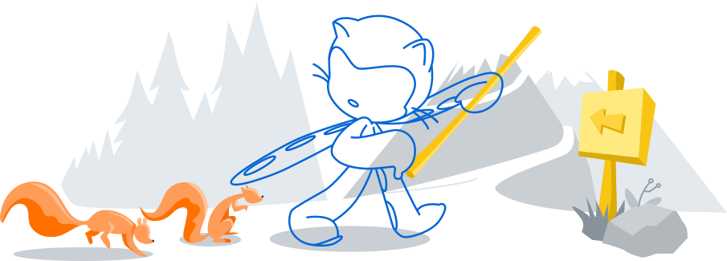
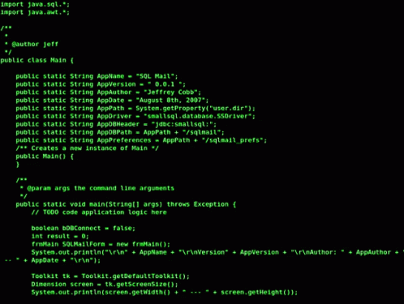
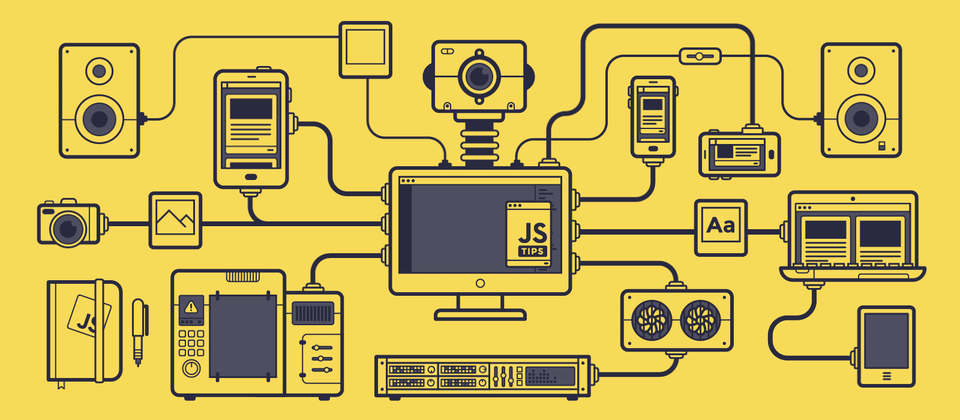
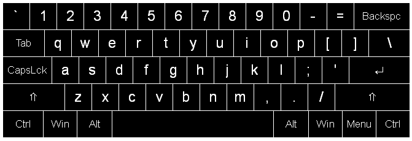
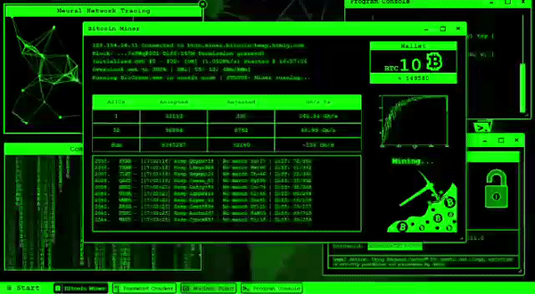
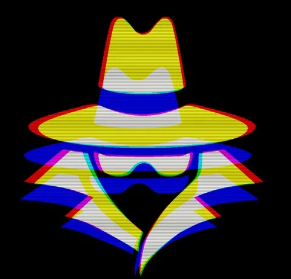

# Hi 👋, I'm Armstrong Khisa

### A passionate Full Stack Software Developer from Nairobi, Kenya 🇰🇪

 

## My Favorite Tools And Technologies ⚙️

> Tools and technologies that I have worked with and I'm interested in

<table>
  <tr>
    <td align="center" width="96">
        
       C#
    </td>
    <td align="center" width="96">
        
       Python
    </td>
    <td align="center" width="96">
        
       Javascript
    </td>
    <td align="center" width="96">
        
       C++
    </td>
       <td align="center" width="96">
        
       Django
    </td>
       <td align="center" width="96">
        
       Github
    </td>
          <td align="center" width="96">
        
       Rest API
    </td>
          <td align="center" width="96">
        
       React
    </td>
    <td align="center" width="96">
        
       Nginx
    </td>
  </tr>
  <tr>
    <td align="center" width="96">
        
       Git
    </td>
    <td align="center"  width="96">
        
       GitLab
    </td>
    <td align="center"  width="96">
        
       HTML
    </td>
    <td align="center" width="96">
        
       CSS
    </td>
    <td align="center"  width="96">
        
       Bootstrap
    </td>
    <td align="center" width="96">
        
       Tailwind
    </td>
        <td align="center" width="96">
        
       JQuery
    </td>
        <td align="center" width="96">
        
       PostgreSQL
    </td>
            <td align="center" width="96">
        
       ASP.NET
    </td>
  </tr>
   <tr>
    <td align="center" width="96">
        
       Redis
    </td>
        <td align="center" width="96">
        
       Postman
    </td>
            <td align="center" width="96">
        
       Linux
    </td>
    <td align="center" width="96">
        
       Dart
    </td>
    <td align="center" width="96">
        
       RabbitMQ
    </td>
    <td align="center" width="96">
        
       Sentry
    </td>
    <td align="center" width="96">
        
       Celery
    </td>
    <td align="center" width="96">
        
       Docusaurus
    </td>
    <td align="center" width="96">
        
       Pytest
    </td>
  </tr>
 <tr>
 </tr>
</table>

### 🏆GitHub Trophies

    

##  Github Profile States

- Note : **Top languages is only a metric of the languages my public code consists of and doesn't reflect experience or skill level.**

### 📊 GitHub States

## ✨ Vibes

  
  
  
  
  

## 🚀 Featured Projects

  
  

  
  

  
  

<a href="https://armstrong-portfolio-ten.vercel.app/"><b>🌐 View my full portfolio →</b></a>

<!-- Contribution Snake -->

  
  
  

<!-- Footer -->

